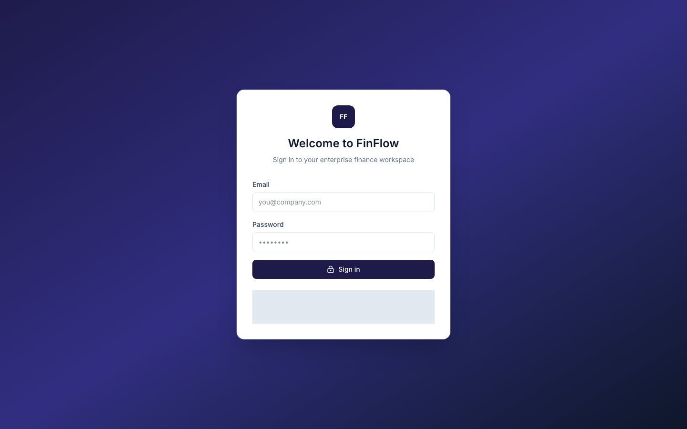
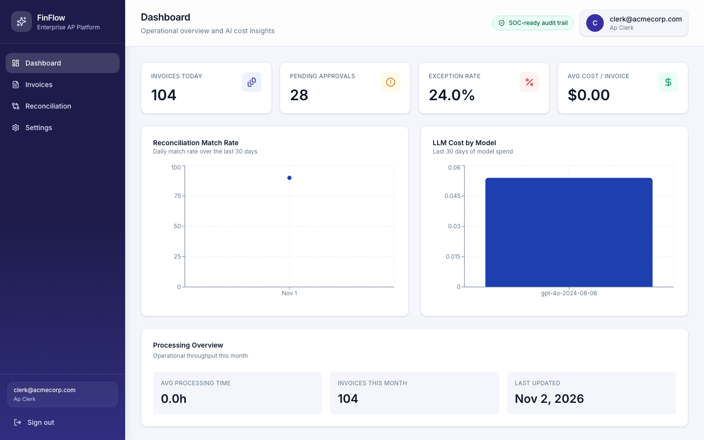
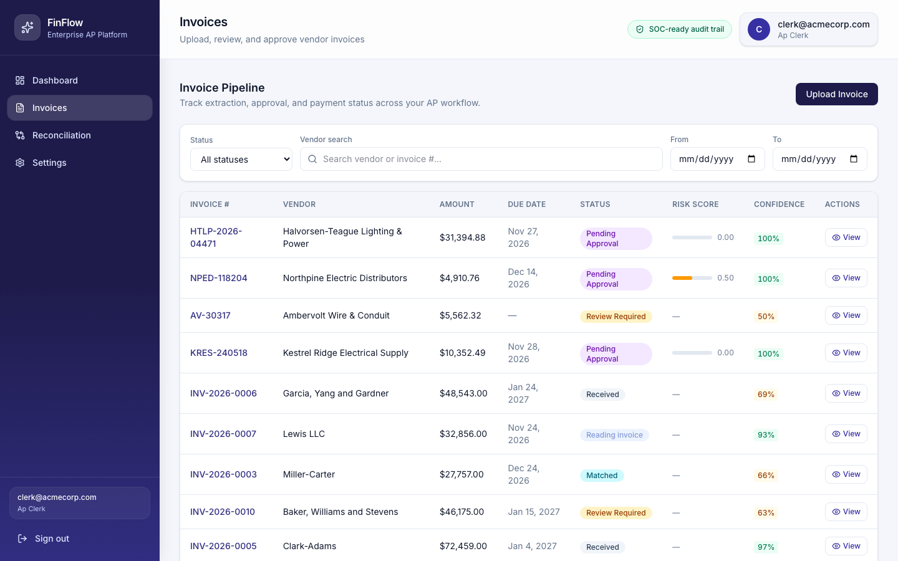
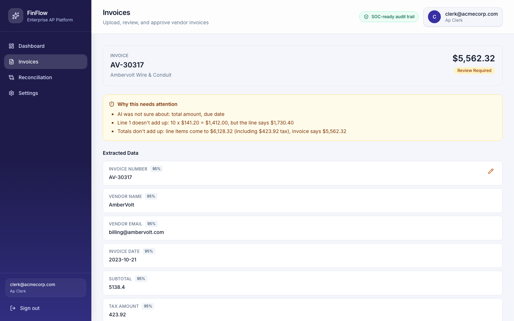
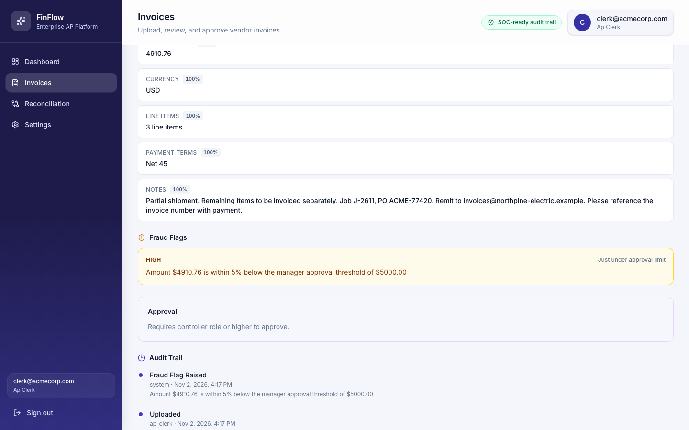
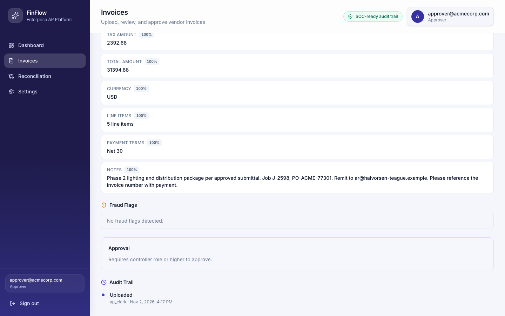
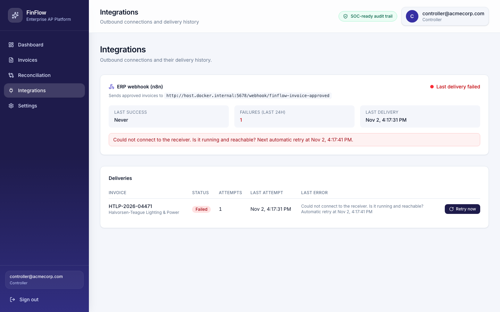
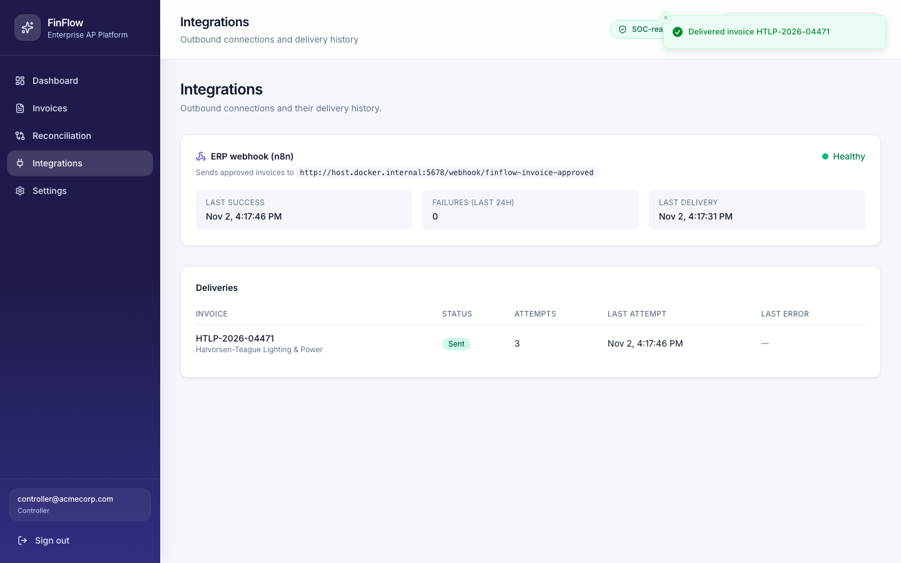
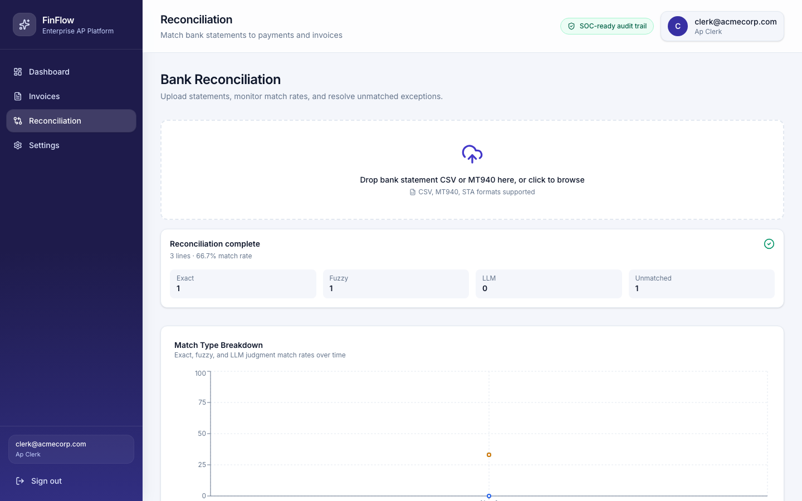
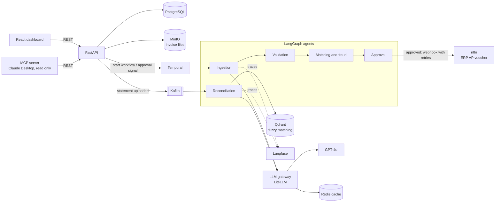

# FinFlow

AI invoice automation for accounts payable, from the vendor bill to bank reconciliation.

> All data in this project is synthetic: the companies, vendors, invoices, payments and bank
> lines are generated by a seed script, and the electrical suppliers in the demo invoices are invented.

## The problem

Accounts payable teams still type invoice data by hand, chase approvals by email and match
bank lines to payments in spreadsheets. Mistakes slip through: a misread total, a duplicate
bill, an amount set just under an approval limit. FinFlow reads each invoice with AI, checks it
with plain rules, routes it to the right person for approval and reconciles the payment
against the bank statement. People keep every decision; the software does the reading,
checking and matching.

## Demo walkthrough

**1. Sign in.** Each user has a role: AP clerk, approver, controller or auditor.



**2. Dashboard.** Today's invoices, pending approvals, exception rate and AI cost per model.



**3. Invoice list.** The four demo invoices after upload, each with status, risk score and AI confidence.



**4. A messy scan goes to a person.** The AI was unsure and the numbers do not add up, so the invoice waits in Review Required with the reasons spelled out.



**5. Fraud check.** An amount just under the $5,000 approval limit is flagged and sent to the controller.



**6. Role-based approval.** An approver cannot sign off on an invoice above their limit.



**7. Integration failure is visible.** With the ERP receiver (n8n) down, the approval still succeeds and the Integrations page turns red.



**8. Recovery.** After the receiver is back, "Retry now" delivers the invoice and the page turns green.



**9. Bank reconciliation.** A demo bank statement is matched to payments: exact first, then fuzzy, with the rest left for a person.



## How it works



The agent steps:

1. **Ingestion:** GPT-4o reads the PDF or scan and returns every field with a confidence score.
2. **Validation:** rules check required fields and that line items, tax and total add up.
3. **Matching and fraud:** the invoice is tied to a known vendor and checked for duplicates, amounts just under a limit, unusual amounts and too many invoices in a short time.
4. **Approval:** a policy picks the approver role from the amount and the fraud checks, then the workflow waits for a person.
5. **Reconciliation:** bank lines are matched to payments, exact match first, then fuzzy (Qdrant), then GPT-4o for hard cases; anything left goes to an exception queue.

## Key design decisions

- **AI never approves.** People approve. The only automatic approval is a fixed rule for invoices under $1,000 with no high-risk fraud flags and numbers that add up.
- **Low confidence goes to a person.** If the AI is unsure, the invoice stops and waits for a person instead of moving on to approval.
- **Rules first, AI for the hard cases.** Fraud checks, approval routing and exact matching are plain rules; the model handles reading documents and the leftover reconciliation cases.
- **Totals math check.** Quantity x unit price must match each line, and lines plus tax must match the total, within one cent. If not, the invoice is never auto-approved and the clerk can correct the numbers, with every edit in the audit trail.
- **The webhook never blocks an approval.** It runs in the background with a 3 second timeout, retries after 10, 30 and 90 seconds, and sends an `Idempotency-Key` so the receiver can ignore duplicates.
- **The MCP server is read only.** Claude can answer questions, but approving stays in the app.

## Integrations

- **Approval webhook to n8n.** When an invoice is approved, FinFlow posts it to `APPROVAL_WEBHOOK_URL`. The included n8n workflow ([`integrations/n8n/finflow_erp_voucher.json`](integrations/n8n/finflow_erp_voucher.json)) turns it into an ERP accounts-payable voucher whose number stays the same on retries.
- **Integrations page.** Controllers see the webhook's health, failures in the last 24 hours, every delivery and a "Retry now" button.
- **MCP server for Claude Desktop.** Four read-only tools: pending approvals, one invoice, invoices needing attention and spend by vendor. Setup: [docs/mcp.md](docs/mcp.md).

## Quality and observability

- **Langfuse:** every extraction is traced, with the model call and the agent step.
- **DeepEval:** golden invoice and reconciliation sets in `evals/` run in their own CI workflow (needs model API keys).
- **pytest:** unit tests in `tests/` (`make test`), run in CI.
- **Playwright:** smoke tests in `e2e/tests/` run in CI; `scripts/take_screenshots.sh` drives the app end to end to produce the screenshots above.
- **Health endpoints:** `/health` (database, Redis, Qdrant, Kafka), `/live`, `/ready`, plus Prometheus metrics at `/metrics`.

## Tech stack

| Area | Technology |
|------|------------|
| Frontend | React 19, TypeScript, Vite, Tailwind CSS |
| API | FastAPI (Python 3.11), cookie-based JWT auth, role-based access |
| Agents and workflows | LangGraph, Temporal |
| Messaging | Kafka |
| AI | GPT-4o through a LiteLLM gateway, Langfuse tracing |
| Data | PostgreSQL, MinIO (files), Qdrant (vectors), Redis (cache, rate limits) |
| Integrations | Outbound webhook to n8n, MCP server (official Python SDK) |
| Testing | pytest, DeepEval, Playwright |
| Local runtime | Docker Compose, uv, npm |

## Run it locally

You need Docker, `uv` and Node.js.

1. Copy `.env.example` to `.env` and fill in `OPENAI_API_KEY`. For tracing, also set
   `LANGFUSE_PUBLIC_KEY`, `LANGFUSE_SECRET_KEY` and `LANGFUSE_HOST` (for example `https://us.cloud.langfuse.com`).
2. Reset and start everything (removes volumes, builds, migrates and seeds):

   ```bash
   make fresh
   ```

3. In a second terminal, start the frontend:

   ```bash
   make frontend
   ```

FinFlow uses host ports 5434 (Postgres) and 6380 (Redis) so it does not clash with local installs.
If another project already uses 6333, 8080, 9092 or 5678, stop it first.

### Local URLs

| URL | What you get |
|-----|--------------|
| http://localhost:5173 | FinFlow app |
| http://localhost:8000/docs | API docs (Swagger) |
| http://localhost:8000/health | Health check |
| http://localhost:8080 | Kafka UI |
| http://localhost:6333/dashboard | Qdrant dashboard |
| http://localhost:8233 | Temporal UI |
| http://localhost:9003 | MinIO console |
| http://localhost:5678 | n8n (optional, see below) |

### Test users (synthetic, created by the seed)

| Email | Password | Role |
|-------|----------|------|
| `clerk@acmecorp.com` | `Test1234!` | AP clerk |
| `approver@acmecorp.com` | `Test1234!` | Approver |
| `controller@acmecorp.com` | `Test1234!` | Controller |
| `auditor@acmecorp.com` | `Test1234!` | Auditor |

### Make commands

| Command | What it does |
|---------|--------------|
| `make fresh` | Full reset: remove volumes, start the stack, migrate, seed |
| `make frontend` | Install frontend packages and run Vite on port 5173 |
| `make up` / `make down` | Start or stop the Docker services |
| `make migrate` | Run database migrations |
| `make seed` | Regenerate and load the synthetic data |
| `make logs` / `make logs-workers` | Follow API or worker logs |
| `make test` | Run the pytest suite |

### Optional: n8n ERP webhook

n8n runs as its own container, outside Docker Compose, so `make fresh` leaves it alone:

```bash
docker volume create finflow-n8n-data
docker run -d --name finflow-n8n --restart unless-stopped -p 5678:5678 \
  -v finflow-n8n-data:/home/node/.n8n \
  -e N8N_HOST=localhost -e N8N_WEBHOOK_URL=http://localhost:5678/ \
  n8nio/n8n:2.45.7

docker cp integrations/n8n/finflow_erp_voucher.json finflow-n8n:/tmp/
docker exec finflow-n8n n8n import:workflow --input=/tmp/finflow_erp_voucher.json
docker exec finflow-n8n n8n publish:workflow --id=FfErpVoucher0001
docker restart finflow-n8n
```

Then add this to `.env` and recreate the services that send it:

```bash
APPROVAL_WEBHOOK_URL=http://host.docker.internal:5678/webhook/finflow-invoice-approved
docker compose up -d --force-recreate --no-deps api temporal-worker
```

Open http://localhost:5678 once to create your own n8n owner account.

### Demo invoices and screenshots

The four demo PDFs in `demo_invoices/` come from a script (reportlab is not a project dependency):

```bash
uv run --no-project --with reportlab --with pillow python scripts/make_demo_invoices.py
```

To regenerate the screenshots, start from a clean stack with the frontend and n8n running:

```bash
make fresh
make frontend            # in another terminal
./scripts/take_screenshots.sh
```

The script uploads the demo invoices, approves one while briefly stopping n8n, uploads
`demo_invoices/demo_statement_seeded.csv` and saves 1440x900 PNGs to `docs/screenshots/`.

## Known limitations and next steps

- **Synthetic data only.** Nothing here has been tested on real invoices or bank files.
- **Scans vary.** GPT-4o reads the noisy demo scan a little differently on each run, so the exact review reasons change.
- **Webhook retries live in memory.** If the worker restarts during the wait, the delivery stays failed until someone clicks "Retry now". Next step: a durable retry queue.
- **Reconciliation uses seeded payments.** Approving an invoice does not create a payment record yet, so the demo statement matches seeded payments. Its dates are fixed, so results can differ on other days.
- **Limited corrections in the UI.** The clerk can fix the invoice number, total and line amounts, but not quantity, unit price or tax.
- **The dev login page shows the test credentials** (hidden in the screenshot above).
- **Next steps:** create payments on approval, a real ERP connector, multi-currency support and a durable outbox for webhooks.
